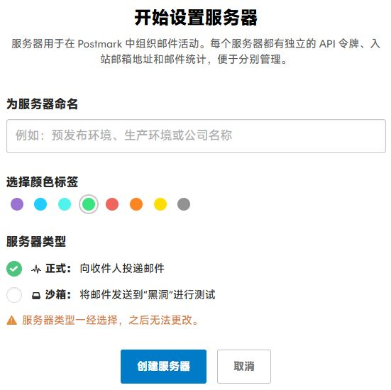
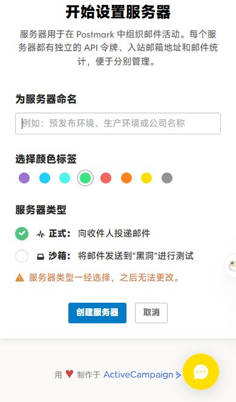

# Postmark 汉化脚本覆盖报告

对应脚本：[`scripts/postmark-zh-cn.user.js`](../scripts/postmark-zh-cn.user.js)，版本 0.1.0。更新日期：2026-10-29。

## 结论

**部分通过，不是全站验收通过。**

- 54 个页面分组、196 个不同状态里，只有 **13 个**在最终版上重放并确认稳定（✅），其余 183 个只有第二轮版本的实站证据（⚠️）。没有标记为“无样本”的状态。
- 最终版相对第二轮只改了账单资料页（A04）的四处提示译文，这四处和 A04 的各状态已在实站复验。其余页面的第二轮证据有参考价值，但不等于最终版已验证。
- 没有再对最终版做一次完整重放，所以**最终版的全站残留英文数是未知的**。
- Toast、服务器返回的英文错误、需要真实数据才出现的状态没有覆盖；CPU 与性能、刷新时的英文闪烁没有测过。完整清单见下文。

## 验证对象

| 项目 | 内容 |
| --- | --- |
| 匹配范围 | 仅 `https://account.postmarkapp.com/*`，文档站不在范围内 |
| 运行方式 | `@run-at document-start`，`@grant none` |
| 验证用的交付文件 | 153307 字节，SHA-256 `82439feb7de946e2b9a8c6b811fa7c164a06c21eefc335c6fed1aa5f2b121b26` |
| 仓库里发布的文件 | 153397 字节，SHA-256 `69848a271da1f64b95fba6aeccb837a871f38f7661cddcdc8c02c12dd4e1aa1b` |

两个文件的差别只在头部元数据（`@namespace`、`@author`、`@license`、`@homepageURL`、`@supportURL`）和开头注释里的两句话；从 `(() => {` 起的代码主体逐字节一致，发布前用 `diff` 核对过。

验证时的安装方式是维护者手动替换 Tampermonkey 里的脚本。扩展里的源码没有回读，所以不能说对**安装副本**逐字节核对过哈希；能确认的是，补词后账单页的三条国家名称和税号提示，在实站上已经看到新译文。

## 验证过程

| 轮次 | 版本 | 采样次数 | 桌面基础页 | 手机基础页 | 滚动到底的页 | 该版本残留类型数 |
| ---: | --- | ---: | ---: | ---: | ---: | ---: |
| 1 | 初版 | 260 | 53 | 0 | 53 | 64 |
| 2 | 第二轮版本 | 322 | 53 | 53 | 53 | 4 |
| 3 | 最终补词版（定向复验） | 13 | 7 | 2 | 1 | 0（仅限所扫范围） |

- **第二轮**重放了：各页的原有状态、SDK 标签、权限/模板/退信弹窗、筛选、图表提示、手机端菜单，以及 Webhook 的六类条件和载荷。扫出的 4 类残留都是账单页的提示，已补齐。
- **第三轮**对补词后的版本做了 13 次实站定向或抽样采样，所扫范围内的非豁免残留为 0。它只覆盖矩阵里标 ✅ 的状态，不是全量重放。
- 补词前后，翻译引擎代码相同，公共词典相同，只有页面分区 A04 的词条不同。

## 词典规模

规模按发布文件里的数组统计：

| 类别 | 数量 |
| --- | ---: |
| 精确词条 | 1083（页面分区 861 + 公共词典 222） |
| 锚定模板（含 `{n}` 等占位符） | 221（页面分区 203 + 公共词典 18） |
| 碎片规则（一句话被拆在多个文本节点里） | 131 |
| 按页面区分的语境覆盖 | 11 |

- 采集阶段共记录 2786 条原文，来自 54 份页面来源。采集阶段的源数据不随仓库公开，这些数字无法由读者复核。
- 含数字、日期的动态模板里，有 211 项只见过一个实例，没有第二个实站证据，也没有虚构（这个数字同样来自采集阶段的统计）。
- 三个国家选项名含 `&#39;`，这是实际观察到的固定写法，按原样匹配。
- 税号提示只改 `textarea` 的 `placeholder`，不改用户填写的备注正文。

## 最终版的效果

下面是“创建服务器”的空白表单，只查看、未提交，截图不含账户区和任何密钥。

## 页面 × 状态覆盖矩阵

图例：

- ✅：最终版实际重放并稳定的状态。
- ⚠️：第二轮版本重放过，最终版没有再次重放；也包括瞬时状态和采样不稳定的状态。
- 旧版本里的“残留为 0”只属于那个版本，不能当作最终版的结论。
- 状态名是采集时的记录标签：`desktop-base` 和 `mobile-base` 是桌面和手机的基础页面；`desktop-end-scan-*` 是逐屏滚到底的记录，不保证每个版本滚动次数相同；`sdk-c-` 是 C# 标签页。

| 页面 | ✅ 最终版已重放 | ⚠️ 仅有第二轮版本的证据 | 备注 |
| --- | --- | --- | --- |
| A02 账户 API 令牌 | — | `desktop-base`、`mobile-base`、`desktop-end-scan-1`、`desktop-end-scan-2` | — |
| A03 账户 IP 允许列表 | — | `desktop-base`、`mobile-base`、`desktop-end-scan-1`、`desktop-end-scan-2` | — |
| A01 账户总览 | — | `desktop-base`、`mobile-base`、`mobile-navigation-open`、`desktop-end-scan-1` | — |
| F03 添加域或签名选择页 | — | `desktop-base`、`domain-form-open`、`mobile-base` | — |
| C06 添加被抑制收件人 | — | `desktop-base`、`mobile-base` | — |
| B05 已归档消息流 | — | `desktop-base`、`mobile-base`、`desktop-end-scan-1` | — |
| A04 账单资料 | `desktop-base`、`new-card-form-preview`、`mobile-base`、`billing-form-settled`、`desktop-end-scan-1`、`desktop-end-scan-2` | — | desktop-end-scan-2：本版本已重放。按该版本逐屏到底的记录对应；不假定滚动次数相同 |
| D02 广播活动 | — | `desktop-base`、`empty-state-settled`、`mobile-base` | — |
| D06 广播设置 | — | `desktop-base`、`mobile-base` | — |
| D05 广播接入说明 | `desktop-base` | `mobile-base`、`sdk-curl`、`sdk-rails`、`sdk-ruby`、`sdk-c-`、`sdk-java`、`sdk-php`、`sdk-node-js`、`sdk-wordpress`、`sdk-smtp` | — |
| D01 广播统计 | — | `desktop-base`、`mobile-base` | — |
| D03 广播抑制 | — | `desktop-base`、`mobile-base` | — |
| D04 广播 Webhook | — | `desktop-base`、`mobile-base` | — |
| A11 修改邮箱 | — | `desktop-base`、`mobile-base`、`desktop-end-check` | — |
| A12 修改密码 | — | `desktop-base`、`mobile-base`、`desktop-end-check` | — |
| F04 新增发件人签名 | — | `desktop-base`、`mobile-base` | — |
| B02 创建服务器 | `desktop-base`、`mobile-base` | `sandbox-radio-preview`、`desktop-end-check` | — |
| B04 创建消息流 | — | `desktop-base`、`mobile-base`、`desktop-end-check` | — |
| C08 添加 Webhook | — | `desktop-base`、`headers-auth-expanded`、`event-option-1`、`event-option-2`、`event-enabled-3`、`open-event-keyboard-preview`、`delivery-payload-expanded`、`mobile-base` | — |
| F05 删除域确认 | — | `desktop-base`、`mobile-base` | — |
| F06 删除签名确认 | — | `desktop-base`、`mobile-base` | — |
| F02 DNS 详情 | — | `desktop-base`、`mobile-base` | — |
| C09 编辑 Webhook 代表 | — | `desktop-base`、`mobile-base` | — |
| E02 入站活动 | — | `desktop-base`、`mobile-base` | — |
| E05 入站演示首页 | — | `desktop-base`、`mobile-base` | — |
| E04 入站设置 | `desktop-base` | `mobile-base` | — |
| E03 入站接入说明 | — | `desktop-base`、`mobile-base` | — |
| E01 入站统计 | — | `desktop-base`、`mobile-base` | — |
| A09 邀请用户 | — | `desktop-base`、`bulk-permissions-dialog`、`mobile-base`、`desktop-end-check` | — |
| B09 布局起始选择 | — | `desktop-base`、`mobile-base` | — |
| B07 布局列表 | — | `desktop-base`、`mobile-base`、`desktop-end-scan-1` | — |
| C02 活动列表 | `desktop-base` | `filters-open`、`show-more-request`、`show-more-loaded`、`search-no-match`、`search-empty-settled`、`mobile-base`、`mobile-navigation-open` | show-more-request：已观察加载类且确认追加记录；没有捕获瞬时加载文字；mobile-navigation-open：采样未得到连续两次相同结果 |
| C03 邮件详情代表 | `desktop-base` | `plain-text-tab`、`raw-source-tab`、`mobile-base`、`hard-bounce-detail`、`bounce-details-dialog`、`download-control-recaptured` | — |
| C11 消息流设置 | — | `desktop-base`、`mobile-base` | — |
| C10 接入说明 | — | `desktop-base`、`sdk-curl`、`sdk-rails`、`sdk-ruby`、`sdk-c-`、`sdk-java`、`sdk-php`、`sdk-node-js`、`sdk-wordpress`、`sdk-activecampaign`、`sdk-smtp`、`mobile-base` | — |
| C01 统计 | — | `desktop-base`、`date-range-menu`、`complaint-tooltip`、`mobile-base`、`calendar-open`、`tag-menu-open`、`chart-point-tooltip` | — |
| C05 抑制列表 | — | `desktop-base`、`mobile-base` | — |
| C07 Webhook 列表 | — | `desktop-base`、`row-actions-open`、`mobile-base` | — |
| A05 套餐与附加服务 | — | `desktop-base`、`desktop-scroll-1`、`desktop-scroll-2`、`desktop-bottom-settled`、`mobile-base`、`desktop-end-scan-1`、`desktop-end-scan-2` | — |
| A10 个人资料 | — | `desktop-base`、`mobile-base`、`desktop-end-scan-1` | — |
| A07 收据详情代表 | — | `desktop-base`、`mobile-base`、`desktop-end-scan-1` | — |
| A06 收据列表 | — | `desktop-base`、`mobile-base`、`desktop-end-scan-1` | — |
| C04 收件人活动代表 | — | `desktop-base`、`mobile-base` | — |
| F01 域与签名列表 | `desktop-base` | `mobile-base` | — |
| B10 服务器 API 令牌 | — | `desktop-base`、`mobile-base` | — |
| B11 服务器 IP 允许列表 | — | `desktop-base`、`mobile-base` | — |
| B12 服务器设置 | — | `desktop-base`、`tooltip-1`、`tooltip-2`、`mobile-base` | — |
| B01 服务器列表 | — | `desktop-base`、`statistics-quick-menu`、`statistics-quick-menu-loaded`、`activity-quick-menu`、`activity-quick-menu-loaded`、`desktop-bottom`、`mobile-base`、`desktop-end-scan-1` | — |
| 共用导航 | — | `user-menu-open`、`help-menu-open`、`mobile-user-menu`、`mobile-help-menu` | — |
| B03 消息流列表 | — | `desktop-base`、`mobile-base`、`mobile-navigation-open`、`desktop-end-scan-1`、`desktop-end-scan-2` | — |
| B08 模板起始选择 | — | `desktop-base`、`desktop-scroll-1`、`template-preview-open`、`mobile-base`、`preview-fragment-direct` | — |
| B06 模板列表 | — | `desktop-base`、`mobile-base`、`desktop-end-scan-1` | — |
| A08 用户列表 | — | `desktop-base`、`mobile-base`、`desktop-end-scan-1` | — |
| B13 模板布局选项 | — | `desktop-base` | — |

## 额外检查逐项结果

| 检查 | 结果 | 证据或限制 |
| --- | --- | --- |
| 不刷新的站内跳转后是否仍翻译 | ⚠️ 部分 | SDK 标签、邮件标签和异步弹窗已重放。主导航的完整生命周期、真实的 History 路由未在实站证实；本地对 `pushState`、`replaceState`、`popstate` 的回放通过 |
| 弹窗、下拉、tooltip | ⚠️ 部分 | 第二轮逐项重放了原来源里的状态；最终版只做了定向复验。没见过的状态组合不算通过 |
| Toast | ❌ 未覆盖 | 为了不改变数据，没有保存、发送、付款或删除来制造提示；试图捕获瞬时提示的观察器没能在只读接口里挂载 |
| 手机布局 | ⚠️ 部分 | 第二轮 53 类基础页都扫过，原有菜单已重放。8 类页面有横向溢出，溢出的元素都是输入框，没有看到中文按钮被截断；没有做“禁用脚本”的尺寸对照，也没遍历所有弹窗组合 |
| 控制台 | ⚠️ 部分 | 正确安装后新页启动 0 错误、0 警告。第二轮累计出现 31 条 `Failed to fetch`、7 条 Meta Pixel 与代码高亮相关的警告；没有做禁用汉化的对照，不能认定为汉化所致，也不能写成“全程无报错”。第三轮抽样窗口无错误、无警告 |
| CPU、长任务、观察器是否循环 | ❌ 实站未验证 | 只读浏览器接口没有性能和观察器 API。本地的无循环检查通过，但不能代替实站 CPU 观测 |
| 只读功能是否正常 | ⚠️ 部分 | 点击、切换标签、GET 搜索、追加记录、未保存的表单和取消已验证；没有抽样复制密钥或邮件、日志内容 |
| 误翻译 | ⚠️ 部分 | 代码、邮件、日志、普通输入和 URL 的保护有本地回放证据；实站不读取真实密钥做逐字比较。模型名这一项不适用于 Postmark |
| 刷新时英文闪烁 | ❌ 未测 | 没有首帧或视频测量，后续截图不能证明没有闪烁 |

## 无法覆盖与未覆盖

**脚本本身翻译不到**

- 支付、客服的跨域 iframe；邮件和模板的 iframe 正文（按范围排除）。
- 图片里的文字、封闭的 Shadow DOM、canvas，以及浏览器原生菜单和表单校验气泡。已见的统计图表是 SVG 加 HTML tooltip，不属于这一类，但图表提示的验证状态见矩阵。

**需要真实数据才出现，没有为覆盖而创建数据**

- 非空的模板和布局及其编辑器、其他成员和邀请、已归档的资源、现成的 IP 规则、未验证的域和签名、广播和入站的真实活动、沙箱专有状态。

**需要真实操作才出现，没有执行**

- 保存结果、邀请和发送、支付、生成或删除令牌、归档、重新启用、Webhook 测试，以及服务器返回的英文错误和 Toast。没有发送空表单来碰运气获取校验文案。

**尚未穷尽**

- 全历史分页、全部筛选组合、内部滚动容器、手机端的全部弹层、瞬时加载文字。“加载更多”已确认会追加记录，但加载中的瞬时文字没有捕获。
- 最终版的完整“页面 × 状态”重放没有再做。

## 豁免规则

以下内容不翻译，不算漏译：

- **品牌、库和套餐名**：ActiveCampaign Postmark、ActiveCampaign、Postmark.js、Postmark、Postman、RequestBin、SpamAssassin、Gravatar、Google App、Google、Gmail、Thunderbird、Chrome Mobile、Chrome、Safari Mobile、Safari、Firefox、Twitter、WordPress、Wordpress、Rails、Ruby、Java、PHP、Node.js、NuGet、Maven、Email Designer、Postmark CX App、Basic、Pro、Platform、visa。
- **技术缩写与正式名称**：API、APIs、SDK、JSON、HTTP、URL、URI、ID、SMTP、REST、DNS、CIDR、HTML、CSS、TLS、CRAM-MD5、UTC、GMT、CNAME、DKIM、SPF、DMARC、TXT、MX、CSV、2FA、IP、POST、LLC、AM、PM、Webhook、Web、Return-Path。
- **代码名称与路径**：curl、C#、npm、composer、postmark、Gemfile、RawEmail、`Content-Type: application/json User-Agent: Postmark`、`/servers`、`/batch`、`pm-bounces`、Postmark Rails Gem、Postmark Ruby Gem、Postmark PHP library、Postmark.js library、Postmark CX App for ActiveCampaign、`PROMO_CODE`、Market St.；`kbd` 标签里的快捷键字符保留。
- **用户数据**：用户输入、资源名称、邮件和日志正文、凭据、邮箱、域名、URL、IP、日期、数字与金额，一律原样保留。

中文句子里出现的合法缩写不算漏译。含品牌名的普通英文句子不会因为含品牌名就整句豁免。

## 给贡献者的提示

1. 新增或修改的英文必须来自真实页面，并记下页面和操作步骤。不要从中文反推英文，不要复制邮箱、令牌、域名、IP 等私人数据。
2. 模板变量（`{n}` 等）必须保留。碎片句子只在完整原句和 DOM 结构都匹配时才改写。
3. 改完先运行 `node tools/check-userscripts.mjs`，再装进浏览器在实站复验。仓库的 CI 只做文本规则检查，不会打开网站。
4. 调试：在控制台执行 `localStorage.setItem('postmark.zhCN.debug','1')` 后刷新，控制台会汇总脱敏后的未命中英文；改成 `'0'` 后刷新关闭。这个日志不能代替逐状态重放，也不能代替隐私审查。
5. 站点改版可能让依赖页面结构的规则失效。失效时脚本的行为是保持原样不改写，不会改错。

## 发布前的核对

- 仓库检查（头部字段、`@match` 范围、禁用写法、密钥特征、语法）通过，GitHub 上的 CI 同样通过。
- 对发布文件做了文本扫描：没有邮箱、UUID 令牌、长密钥串、IP 地址和本机路径。
- 写入页面的方式只有 `nodeValue` 和一处 `setAttribute`。
- 抽查了删除、取消、归档等危险操作词条，译文与原意一致。
- 本报告没有把未验证的内容写成已覆盖。
